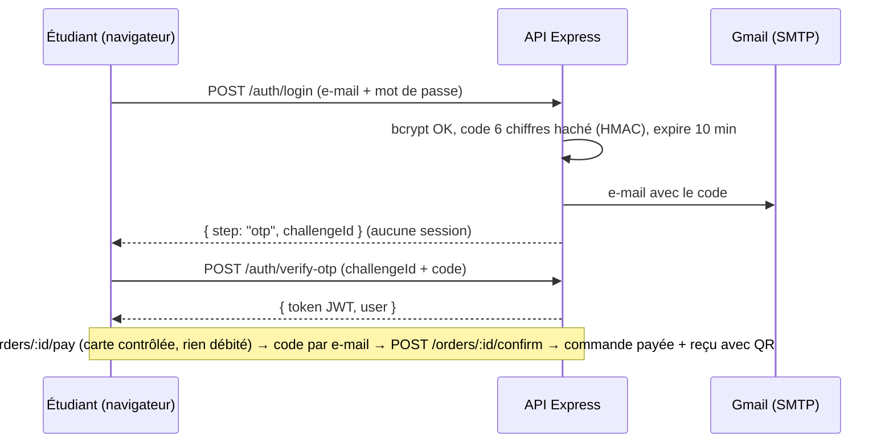

# CampusSave : les invendus du campus à prix étudiant

Application web complète (React + Express) qui permet aux étudiants de réserver à prix réduit les invendus des commerces autour de leur faculté, de payer en ligne, et de retirer leur commande avec un **QR code**.

**Nouveauté de cette version : confirmation par e-mail (Gmail) à chaque connexion et à chaque achat** (vérification en deux étapes, codes à 6 chiffres à usage unique).

## Démarrage rapide (2 commandes)

Prérequis : [Node.js 18.18 ou plus](https://nodejs.org) (`node -v` pour vérifier).

```bash
npm install
npm run dev
```

Ouvre **http://localhost:5173**. L'API tourne sur http://localhost:5000.
Sans configuration, l'application est en **mode démo** : aucun e-mail réel n'est envoyé, le code de confirmation s'affiche dans l'interface (bouton jaune). Tout fonctionne immédiatement.

Autre mode « tout-en-un » (un seul serveur, interface compilée) : `npm start` puis http://localhost:5000.

### Comptes de démonstration (mot de passe `Campus123`)

| Rôle | E-mail | Ce que tu peux montrer |
|---|---|---|
| Étudiant | `amine@essect.tn` | Parcours complet, historique, badges, QR code actif |
| Commerçant | `m@cafe.tn` | Console : valider un retrait avec le code du QR |
| Admin | `admin@campussave.tn` | API d'administration (`/api/admin/*`) |

Cartes de test : `4242 4242 4242 4242` (accepté), `4000 0000 0000 0002` (refusé). Date future et 3 chiffres au choix.

## Activer les vrais e-mails Gmail

1. Copie le modèle : `copy server\.env.example server\.env` (Windows) ou `cp server/.env.example server/.env`.
2. Sur ton compte Google : **Sécurité → Validation en 2 étapes** (à activer), puis **Mots de passe d'application → créer « CampusSave »**. Google affiche un mot de passe de 16 caractères.
3. Dans `server/.env` renseigne :
   ```
   SMTP_USER=ton.adresse@gmail.com
   SMTP_PASS=abcd efgh ijkl mnop
   MAIL_FROM=CampusSave <ton.adresse@gmail.com>
   DEMO_EMAIL=ton.adresse@gmail.com
   ```
   `DEMO_EMAIL` fait utiliser **ton adresse** au compte étudiant de démo : tu reçois les vrais codes dans ta boîte pendant la soutenance.
4. Relance `npm run dev`. Le terminal affiche « SMTP prêt » et le bandeau « Mode démo » disparaît de l'interface.

Ne mets jamais ton vrai mot de passe Gmail : uniquement le mot de passe d'application. Le fichier `.env` est ignoré par Git.

## Firebase (Authentication + Firestore) et paiement Konnect

Par défaut tout fonctionne sans compte (données dans un fichier JSON, paiement simulé). Pour respecter la stack du cahier des charges, deux blocs s'activent en remplissant `server/.env` (voir les commentaires de `server/.env.example`) :

| Bloc | Variables | Effet |
|---|---|---|
| **Firebase** | `FIREBASE_SERVICE_ACCOUNT`, `FIREBASE_WEB_API_KEY` | Les comptes vivent dans **Firebase Authentication** ; les données (`users`, `shops`, `offers`, `orders`, `favorites`, `meta`) vivent dans **Firestore**. Aucun mot de passe n'est stocké par l'application. |
| **Konnect** | `KONNECT_API_KEY`, `KONNECT_WALLET_ID` | Le paiement se fait sur la page sécurisée de **Konnect** (bac à sable par défaut). Le serveur vérifie le statut auprès de Konnect avant de valider la commande, puis envoie l'e-mail de confirmation avec le QR code. |

Mise en route Firebase : créer un projet, activer *Authentication → E-mail/Mot de passe*, créer la base *Firestore*, coller `server/firebase/firestore.rules` (tout accès direct refusé : seule l'API y accède), générer une clé de compte de service (`server/serviceAccountKey.json`, **jamais sur GitHub**), puis renseigner `FIREBASE_WEB_API_KEY`. Au premier démarrage, la base de démonstration est créée dans Firestore et les 3 comptes de démonstration dans Firebase Authentication (mot de passe `Campus123` : supprime-les avant une vraie mise en ligne).

Mise en route Konnect : créer un compte sur konnect.network, un portefeuille *sandbox*, puis copier l'identifiant du portefeuille et la clé API. Vérifie les URL et les champs dans la documentation officielle de Konnect (`KONNECT_BASE_URL` permet de changer d'environnement). Carte de test : voir la documentation Konnect.

**Application mobile Flutter** : elle doit utiliser le même backend. Soit elle appelle `/api/auth/login` puis `/api/auth/verify-otp` (même parcours que le web), soit tu actives `FIREBASE_ID_TOKEN_AUTH=true` et elle envoie directement son ID token Firebase dans `Authorization: Bearer …` (le code e-mail n'est alors pas demandé). Le client Flutter lui-même n'est pas dans ce dépôt.

## Fonctionnalités

**Étudiant** : inscription avec confirmation d'e-mail, connexion en deux étapes, catalogue public (recherche, catégories, type de commerce, prix max, tri, stock, favoris), panier (un commerce par commande), réservation avec stock bloqué 10 minutes, paiement par carte confirmé par code e-mail, reçu HTML avec QR code envoyé par e-mail, ticket avec suivi en direct, ajout à l'agenda (.ics), partage, impression, « recommander », tableau de bord (repas sauvés, économies, CO₂, graphique 7 jours, niveaux, série, badges), profil et changement de mot de passe.

**Commerçant** : inscription du commerce (validée par l'administrateur), **publication, modification et suppression des offres** (prix initial et réduit, quantité, photo, horaires de retrait), console de validation des retraits (code du QR), liste des commandes, chiffres du jour.

**Plateforme** : API d'administration (commerces, utilisateurs, statistiques), chiffres d'impact publics sur l'accueil, PWA installable (hors-ligne partiel), thème clair/sombre, palette de commandes `Ctrl+K`, accessibilité (navigation clavier, `aria`, focus visibles, `prefers-reduced-motion`), SEO (métadonnées, Open Graph, JSON-LD).

## Comment fonctionne la confirmation par e-mail



Règles appliquées côté serveur : code généré avec `crypto.randomInt`, jamais stocké en clair, **usage unique**, expiration 10 min, **5 essais maximum** puis verrouillage, renvoi limité (30 s d'attente, 5 envois), code lié à un usage (un code d'achat ne peut pas servir à se connecter), montant rappelé dans l'e-mail d'achat.

## Architecture

```
campussave-pro/
├── client/            React 18 + Vite + React Router + Zustand + Axios (PWA)
│   └── src/ pages, components (OtpForm, OfferCard, CommandPalette…), services, store, utils
├── server/            Node + Express (API REST)
│   ├── src/routes     auth, offers, orders, misc (admin, stats, shops)
│   ├── src/services   otp, payment (simulé, point d'intégration Stripe/Konnect), orders
│   ├── src/mail       Nodemailer (Gmail/SMTP) + gabarits HTML
│   ├── src/db.js      base JSON (remplaçable par Firestore / MongoDB / PostgreSQL)
│   └── test/          10 tests d'intégration
├── docs/SOUTENANCE.md Plan de démo et questions du jury
├── Dockerfile, docker-compose.yml, .github/workflows/ci.yml
```

## API (contrat v1 respecté, étendu)

| Méthode | Route | Rôle | Description |
|---|---|---|---|
| POST | `/api/auth/register` | public | Inscription → code e-mail |
| POST | `/api/auth/login` | public | Mot de passe → code e-mail |
| POST | `/api/auth/verify-otp` | public | Code → `{ token, user }` |
| POST | `/api/auth/resend-otp` | public | Nouveau code (délai 30 s) |
| GET / PUT | `/api/auth/me` | connecté | Profil |
| PUT | `/api/auth/password` | connecté | Changer le mot de passe |
| GET | `/api/offers`, `/api/offers/:id` | public | Catalogue (commerces `approved`) |
| GET / POST | `/api/favorites[/:offerId]` | student | Favoris |
| POST | `/api/orders` | student | Réserver (stock bloqué 10 min) |
| GET | `/api/orders/mine` | student, merchant | Mes commandes / commandes reçues |
| POST | `/api/orders/:id/pay` | student | Contrôle carte + code e-mail |
| POST | `/api/orders/:id/confirm` | student | Code correct → payée + reçu QR |
| POST | `/api/orders/:id/cancel` | student | Annule une réservation |
| POST | `/api/orders/validate` | merchant | Valide le retrait (contrat v1) |
| GET | `/api/shops/mine` | merchant | Mon commerce |
| GET/PATCH | `/api/admin/shops`, `/users`, `/stats` | admin | Administration (contrat v1) |
| GET | `/api/public/stats`, `/api/health` | public | Chiffres d'impact, état |

Erreurs : `{ "message": "texte lisible" }` avec le bon code HTTP (400, 401, 402, 403, 404, 409, 429).

## Sécurité

Mots de passe hachés (bcrypt), JWT 7 jours, vérification en deux étapes par e-mail (connexion et achat), limitation de débit sur l'authentification, validation de toutes les entrées (zod), en-têtes `helmet` avec CSP stricte, CORS restreint, réponses d'erreur génériques (pas de fuite d'informations), temps de réponse constant au login (anti-énumération d'e-mails), aucune donnée de carte stockée (marque et 4 derniers chiffres uniquement), contrôle d'appartenance sur chaque commande, comptes désactivables.

## Tests et qualité

```bash
npm test          # 10 tests d'intégration (login OTP, verrouillage, achat OTP, expiration, stock, rôles…)
npm run build     # compilation de production + service worker PWA
```
La CI GitHub (`.github/workflows/ci.yml`) lance les tests et la compilation à chaque push.

## Déploiement

- **Un seul serveur** : `npm run build` puis `npm run start -w server` avec `NODE_ENV=production`, `JWT_SECRET`, `OTP_SECRET`, `SMTP_USER`, `SMTP_PASS` (Render, Railway, VPS).
- **Docker** : `docker compose up --build` (variables dans `server/.env`).
- En production le mode démo est désactivé : aucun code n'est renvoyé par l'API, Gmail est obligatoire.

## Limites connues (à annoncer honnêtement)

- Le **paiement est simulé** (aucun débit réel) : `server/src/services/payment.js` est le point d'intégration d'une passerelle (Stripe, Konnect, Flouci).
- La base de données est un **fichier JSON** : suffisant pour la démo, à remplacer par une vraie base en production (couche isolée dans `db.js`).
- Création d'offres par le commerçant (multipart), interface d'administration et scanner de QR par caméra : non inclus ici (l'API admin l'est).
- Gmail limite l'envoi (environ 500 e-mails par jour pour un compte gratuit) : en production, utiliser un service transactionnel (Brevo, SendGrid, Mailgun).

## Crédits

Photos de plats : issues du projet fourni par l'équipe (générées par IA). Icônes : Lucide. Polices : Bricolage Grotesque, Instrument Sans, DM Mono.
